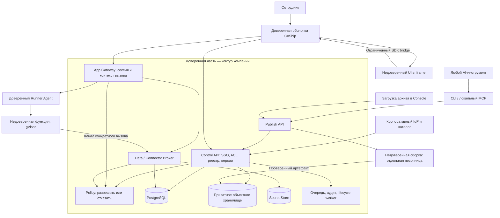
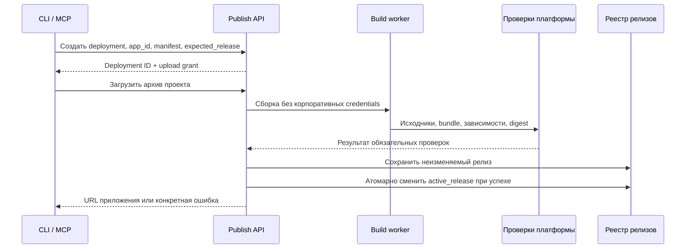

# CoShip — архитектура MVP

Статус: проект для реализации. Дата: 10 октября 2026 года. Календарный план не входит в документ.

## 1. Продуктовый контракт

**CoShip превращает папку с приложением в управляемый корпоративный ресурс, которым можно поделиться как документом.**

Основной сценарий:

1. Сотрудник просит свой AI-инструмент создать внутреннее приложение.
2. Агент получает описание возможностей CoShip и использует его SDK.
3. Пользователь говорит «опубликуй». CLI или локальный MCP-сервер загружает проект.
4. CoShip собирает и проверяет приложение, затем возвращает корпоративную ссылку.
5. Через «Поделиться» сотрудник выбирает людей или группы и права доступа.
6. Коллега входит через корпоративный аккаунт и работает с разрешёнными данными.

Git, облачный аккаунт, настройка сервера, OAuth-приложение и администрирование БД не входят в пользовательский сценарий. Корпоративный администратор один раз настраивает установку, каталог и допустимые возможности. Браузерная загрузка архива использует тот же Publish API и покрывает инструменты без CLI/MCP.

«Любой AI-инструмент» означает открытые интерфейсы публикации и документированный контракт приложения. В MVP поддерживается **статический веб-интерфейс + JS/TS-функции**, а не любой язык, Docker-образ или постоянно работающий сервер.

## 2. Главные архитектурные решения

| Вопрос | Решение MVP | Причина |
|---|---|---|
| Устройство платформы | Модульный backend; отдельные процессы Data Broker, сборки и исполнения | Простая разработка при явных границах доверия |
| Размещение | Отдельная установка для одной компании в выбранной стране | Понятный контроль данных и меньше рисков межклиентской изоляции |
| Интерфейс | Доверенная оболочка CoShip + изолированный интерфейс приложения | Кнопки доступа и корпоративная сессия принадлежат платформе |
| Backend приложений | Короткие JS/TS-функции; отдельная песочница на вызов | Нет постоянного сервера на каждое приложение и памяти между пользователями |
| Данные | PostgreSQL за Data Broker; декларативные коллекции | Код не получает SQL-подключение, DDL или управление политиками |
| Права | App ACL + ограничения набора данных + полномочия текущего пользователя | Публикация не превращается в повышение прав |
| Секреты | Платформенный Secret Store; использование через Connector Broker | Секрет нельзя прочитать из кода приложения |
| Публикация | Один API, CLI и локальный MCP поверх него | Независимость от конкретного агента |
| Версии | Неизменяемые релизы, активная версия — отдельный указатель | Атомарное переключение и понятный откат |
| Экономика | Общие сервисы на компанию, вычисления по запросу | Спящее приложение не держит отдельный процесс |

Рекомендуемый стек: TypeScript для Console/API/SDK/CLI/MCP, React для Console, Go для небольшого Runner Agent, PostgreSQL, S3-совместимое хранилище, Linux + containerd + gVisor для песочниц. Это выбор реализации, не требование к AI-инструменту. Релизы платформы фиксируют проверенные версии зависимостей.

## 3. Компоненты и границы доверия



Диаграмма показывает логические зависимости. У недоверенной сборки нет credentials хранилища: артефакт извлекает и сохраняет доверенный worker. Аналогично функцию связывает с Broker доверенный Runner; приложение не выбирает личность или права этого канала.

**Control plane** хранит приложения, владельцев, ACL, политики, каталог, релизы и задания. **Data plane** обслуживает интерфейсы, вызовы функций и доступ к данным. Оба размещаются в контуре клиента; обязательного зарубежного управляющего сервиса нет.

Policy — модуль с одной реализацией правил внутри доверенных API, а не дополнительный микросервис в MVP. Данные ACL и версии политик общие. Data Broker запускается отдельным процессом с отдельной ролью БД. Runner и build worker не имеют доступа к административным API, DB credentials или Secret Store.

## 4. Что именно гарантирует безопасность

Гарантия: **код не может назначить себе права, отключить проверку доступа, получить ключ БД или прочитать секрет коннектора через API платформы**. Прямого пути к этим ресурсам у него нет. Даже обращение в обход SDK проходит через те же проверки.

Граница гарантии: код может злоупотребить уже разрешёнными данными и операциями. Произвольный интерфейс, которому выдали данные, способен их показать, преобразовать или попытаться передать дальше. CSP, песочница и сканирование снижают риски, но не доказывают отсутствие утечек. Компрометация самой платформы, администратора инфраструктуры или браузера также остаётся отдельным риском.

Отсюда обязательные решения:

- Проверять пользователя, приложение, текущий релиз, операцию и набор данных на каждом запросе.
- Не выполнять функции с полномочиями владельца приложения.
- Запрещать исходящую сеть функций по умолчанию, включая DNS, metadata endpoints и внутренние адреса.
- Изолировать память и временные файлы между вызовами разных пользователей.
- Не смешивать чтение частных данных с записью в общедоступную область без отдельной модели переноса данных.
- Считать сборки, зависимости и файлы проекта недоверенными наравне с исполняемым кодом.

gVisor выбран как дополнительный барьер изоляции. Он сам по себе не задаёт сетевые политики и не заменяет архитектуру доступа; лимиты и ограничения сети задаются платформой вне песочницы. [Модель безопасности gVisor](https://gvisor.dev/docs/architecture_guide/security/).

## 5. «Поделиться» и модель прав

У приложения есть `org_id`, владелец и ACL с пользователями/группами. Созданное приложение доступно только создателю. Публичные ссылки, гости и анонимные API в MVP отсутствуют; знание URL не даёт доступа.

| Роль | Запуск и чтение | Изменение данных приложения | Комментарии | Публикация кода | Изменение ACL |
|---|---|---|---|---|---|
| Viewer | Да | Нет | Да | Нет | Нет |
| User | Да | Да, в пределах разрешённых операций | Да | Нет | Нет |
| Builder | По отдельной роли Viewer/User | По отдельной роли User | При наличии доступа к приложению | Да | Нет |
| Owner | По отдельной роли Viewer/User | По отдельной роли User | При наличии доступа к приложению | Да | Да |

Viewer/User — роли работы с приложением, Builder/Owner — независимые полномочия управления кодом и доступом. Создатель получает Owner + User. Разделение позволяет пользоваться формой без права менять её код и передавать техническое владение без автоматического чтения данных. Owner может менять ACL только в пределах корпоративной политики распространения; такое изменение — отдельное аудируемое действие. Администратор компании также не получает неявного доступа ко всем бизнес-данным; аварийный доступ оформляется отдельно. «Сделать копию» — отдельное разрешение `can_copy`, по умолчанию у Builder/Owner.

Издатель кода всё же является доверенной ролью в отношении поведения приложения: он определяет, как обрабатываются данные посетителей. Разделение ролей не делает заведомо враждебного издателя безопасным. Для корпоративных источников право публикации ограничивается назначенными авторами и политикой установки; более строгая модель требует отдельного контроля выпуска или декларативного UI.

Проверка запроса:

```text
allow = active_user
    AND same_organization
    AND active_app
    AND app_acl_allows(user, operation)
    AND release_capabilities_allow(operation, resource)
    AND dataset_policy_allows(user, operation, resource)
    AND source_policy_allows(user, operation, resource)  // при наличии источника
```

Группы берутся из доверенного каталога. Права всех пользователей приложения не складываются в одну общую роль процесса. Два человека, открывшие одну ссылку, могут иметь разный доступ к подключённому источнику.

### Собственная база приложения — основной профиль MVP

Коллекции создаются внутри нового `data_space` и наследуют ACL приложения. Share с отделом продаж выдаёт выбранной группе доступ к приложению и его собственной базе. Viewer читает, User редактирует; права дополнительно ограничены объявленными операциями релиза. Смена ACL применяется атомарно к приложению и его `data_space`.

Здесь все читатели приложения имеют одну область видимости записей. Персональные строки, разные ACL у отдельных записей и закрытые колонки в общей коллекции не поддерживаются в первом профиле. Для другого круга читателей создаётся отдельное приложение/пространство. Это делает смысл кнопки «Поделиться» предсказуемым.

Share явно показывает: «Эта группа получит доступ ко всем данным приложения». Изменить ACL может только субъект с правом распространения этих данных; политика компании может ограничить разрешённые группы. Автор приложения не получает права делиться любыми данными компании.

### Корпоративный источник — отдельная граница

Для CRM, HR и существующих БД share открывает приложение, но не выдаёт новые права в источнике. Требуется заранее разрешённая привязка и проверка пользователя в источнике либо администратором заданная политика набора данных.

Пример: приложение доступно продажам и финансам. Анна видит разрешённые ей сделки, Борис — разрешённые ему. Ни Анна, ни функция не получают доступ ко всему, что доступно Борису или владельцу приложения.

Контракт коннектора закладывается сразу. Конкретный коннектор включается только после реализации его авторизации; без неё возвращается `CONNECTOR_NOT_SUPPORTED`. Первый допустимый профиль — чтение одного одобренного набора данных, без произвольного SQL и без общего хранилища, куда код мог бы записать прочитанные личные данные для других пользователей. Универсальные коннекторы не входят в ядро MVP.

Профили `app-shared` и `source-readonly` взаимоисключающие и фиксируются платформой для приложения. У `source-readonly` нет app-controlled persistent writes: ни в собственные коллекции, ни через другие bindings, ни в объектное хранилище. Policy отклоняет несовместимое сочетание grants при создании, публикации и каждом вызове. Смена профиля требует нового приложения с пустым пространством, а не изменения manifest поверх старых данных. Это ограничивает автоматический перенос между аудиториями, но не отменяет описанные ограничения произвольного frontend.

## 6. Вход, корпоративные группы и отключение сотрудников

CoShip использует OIDC: Google Workspace или Microsoft Entra ID. Идентичность — `issuer + subject`, привязанные к организации. Проверяются подпись, issuer, audience, срок, nonce и корпоративная принадлежность. Email используется для отображения, не как постоянный ID. Для Google принадлежность Workspace проверяется по подписанному `hd`, а не по суффиксу email. [Google OIDC](https://developers.google.com/identity/openid-connect/openid-connect).

Подключение организации подтверждает администратор. Допустимые issuer и Microsoft tenant ID либо домены Google Workspace задаются в конфигурации установки; совпадения имени компании или email недостаточно для вступления в организацию.

Google/Microsoft login и синхронизация каталога — разные интеграции. OIDC не гарантирует оперативного получения групп и отключений. В Microsoft группы могут отсутствовать в токене из-за ограничений его размера. [Microsoft: group claims](https://learn.microsoft.com/en-us/security/zero-trust/develop/configure-tokens-group-claims-app-roles).

Directory Adapter получает пользователей, группы и статус через разрешённый API каталога или SCIM. Для установки обязателен работающий адаптер выбранного клиента. События дополняются периодической сверкой; ручное отключение в Console действует независимо от доступности каталога.

Проектный предел устаревания каталога — 5 минут, настраиваемый в установке. Это цель реализации, не обещание провайдера: после истечения допустимого возраста неподтверждённые корпоративные полномочия перестают давать доступ. После получения события отключения новые запросы блокируются сразу; активные вызовы отменяются по возможности. Уже показанные данные нельзя отозвать из памяти пользователя.

Сессии принадлежат CoShip. Их токены хранятся вне app-кода; административные cookies — `Secure`, `HttpOnly`, host-only. Применяются CSRF-защита и проверка origin. При отключении сотрудника отзываются браузерные сессии, CLI/MCP credentials и полномочия активных вызовов. Broker сверяет актуальные `authz_version` и статус, а не полагается только на срок токена.

Для полностью закрытого контура используется локальный OIDC IdP. Google/Entra требуют доступа к облачным endpoint; их нельзя считать офлайн-SSO. Нативный SAML не обязателен для MVP, его может завершать корпоративный identity broker.

## 7. Исполнение приложения

### Интерфейс

Доверенная оболочка показывает название, владельца, «Поделиться», версии, комментарии и копирование. Приложение исполняется в iframe с отдельного домена, отделённого от административной cookie-зоны. Для MVP предпочтителен opaque origin: `sandbox="allow-scripts"` без `allow-same-origin`. SDK работает через узкий MessageChannel с оболочкой. Учитываются ограничения такого режима для модулей и загрузки ресурсов; поддерживаемый bundler выдаёт совместимый пакет. [Модель iframe sandbox](https://developer.mozilla.org/en-US/docs/Web/HTML/Reference/Elements/iframe).

Оболочка связывает канал с конкретным iframe, app/release и сессией. Проверяются источник сообщения, схема, разрешённый метод и размер; `origin: null` сам по себе не является доказательством доверия. Через bridge доступны только app-scoped вызовы данных и функций, не управление ACL, публикацией или секретами.

CSP устанавливает Gateway: внешние скрипты, формы, изображения и соединения запрещены; ресурсы приложения доставляются контролируемым способом. У iframe нет top-navigation, popups, service workers и прямого доступа к корпоративной сессии. Приватные артефакты проверяются при выдаче, общедоступного bucket нет. Пользовательские ответы не попадают в общий HTTP-кеш.

Это защищает оболочку и ограничивает каналы передачи, но не является полной DLP для произвольного JavaScript. В частности, sandbox/CSP нельзя считать универсальным запретом всех способов навигации и передачи уже показанной информации. Для данных, где нужна более сильная гарантия, требуется отдельный режим с доверенными UI-компонентами или управляемым браузером; он за пределами первого MVP.

### Серверные функции

Gateway проверяет сессию и ACL, фиксирует digest релиза и создаёт контекст: `org_id`, `app_id`, `release_id`, `user_id`, `invocation_id`, `authz_version`, разрешённые операции и срок. Пользовательские заголовки идентичности удаляются.

Runner открывает аутентифицированный, привязанный к вызову канал в Broker. Credentials этого канала остаются у Runner/proxy вне песочницы. App-код видит объект `ctx`, но изменение `ctx.user_id` не меняет identity канала. Broker получает подлинный контекст от доверенной стороны.

Каждый вызов получает новый gVisor sandbox: read-only root, ограниченный tmpfs, непривилегированный UID, лимиты CPU/RAM/процессов/ответа и timeout. Нет host mounts, container socket, облачной service account или доступа к управляющей сети. Базовые лимиты MVP: 256 MiB RAM, 10 секунд wall time, 1 MiB JSON-ответ; установка может их уменьшить. Это проектные defaults, требующие нагрузочной проверки.

После ответа или ошибки песочница уничтожается, канал отзывается. Один и тот же процесс приложения не обслуживает разных пользователей. Допустим общий кеш неизменяемых слоёв и пул чистых базовых песочниц, ещё не получавших пользовательские данные. Кеш ответов, глобальное app-state и переиспользование прогретой памяти отсутствуют.

Прямой internet egress запрещён внешним сетевым фильтром. Разрешён только invocation proxy. Внешние операции возможны через Connector Broker с фиксированными адресами и схемами запросов. Произвольный `fetch(url)` через прокси отсутствует: это создало бы SSRF и обход ограничений данных.

## 8. Data Broker, БД и секреты

SDK предоставляет `list`, `get`, `insert`, `update`, `delete` с ограниченными фильтрами, сортировкой и пагинацией. Broker проверяет схему, лимиты, допустимые поля и операцию; строит параметризованный SQL. Сырая SQL-строка, DDL, хранимые процедуры пользователя и `service_role` отсутствуют.

MVP хранит записи в платформенной таблице вида:

```text
records(org_id, data_space_id, collection_id, id, payload_jsonb, revision,
        created_by, created_at, updated_at)
```

Системные поля задаёт Broker. JSON Schema описывает пользовательские поля. Индексы — только из разрешённого набора, без пользовательских выражений. Размер записи, число коллекций, объём выборки и суммарное хранилище ограничены квотами. `revision` обеспечивает optimistic concurrency, `idempotency_key` защищает повторяемые записи от дублей.

PostgreSQL RLS добавляет второй слой изоляции по организации и пространству. Runtime DB-role не владеет таблицами, не имеет `SUPERUSER`, `BYPASSRLS`, DDL, `TRUNCATE` или полномочий миграций. Применяются `ENABLE/FORCE ROW LEVEL SECURITY`, проверка чтения и `WITH CHECK` для записи. Параметры доверенного контекста устанавливаются только Broker через `SET LOCAL` внутри транзакции и не остаются в pooled connection. RLS не заменяет проверки Broker. [PostgreSQL: Row Security Policies](https://www.postgresql.org/docs/current/ddl-rowsecurity.html).

Платформенные миграции исполняются отдельной ролью. Миграции app-коллекций декларативны: добавление коллекции/необязательного поля. Удаление полей, изменение типов и массовый пользовательский SQL откладываются. Откат кода не откатывает данные и права; совместимость старого релиза с текущей схемой проверяется перед активацией.

Secret Store хранит ключи коннекторов и refresh tokens с шифрованием; master key находится вне БД, в локальном secret manager/KMS клиента. Секреты не передаются в переменные окружения функций. Вместо `secrets.get()` приложение вызывает `connectors.call(binding, operation, args)`. Broker использует секрет сам, применяет ограничения адреса, операции, пользователя и объёма, очищает ответ от служебных токенов. Произвольный адрес назначения и возврат auth headers запрещены.

По умолчанию коннектор работает с делегированными правами пользователя. Service account допустим только с явно заданной политикой набора данных, а не как способ открыть всем полномочия администратора. Если исходный сервис не позволяет проверить права и такую политику не настроили, подключение недоступно.

## 9. Контракт приложения и совместимость с агентами

Платформа публикует версионированный `/.well-known/coship.json`: runtime ABI, версию SDK, поддерживаемые методы, лимиты, профиль сети и ссылки на схемы. Авторизованный endpoint показывает доступные конкретному автору шаблоны и bindings. Манифест не содержит секретов, списков сотрудников или production-записей.

Пример `coship.json` приложения; это предлагаемый формат, SDK ещё не реализован:

```json
{
  "manifestVersion": "1",
  "name": "Sales Notes",
  "runtime": "coship-js-v1",
  "build": { "command": "npm run build", "output": "dist" },
  "functions": { "summary": "functions/summary.ts" },
  "data": {
    "profile": "app-shared",
    "collections": {
      "notes": {
        "schema": "schemas/notes.json",
        "operations": ["list", "get", "insert", "update"]
      }
    }
  },
  "connectors": []
}
```

Манифест **запрашивает** возможности. Разрешения определяются политикой установки и grant-записями платформы. ACL, public access, секреты, network policy и роль БД не управляются из файла. Неизвестные поля/версии отклоняются. Версия SDK и ABI фиксируются в релизе.

Пример API приложения:

```ts
// Browser SDK: вызов через ограниченный bridge в оболочку CoShip.
const notes = await coship.data.collection("notes").list({ limit: 20 });

// Function SDK: полномочия текущего вызова, без DB URL и секретов.
export default async function summary(input, ctx) {
  const notes = await ctx.data.collection("notes").list({ limit: 100 });
  return { count: notes.items.length };
}
```

CLI:

```text
coship login --server https://coship.company.example
coship init
coship inspect .
coship publish .
coship status <deployment-id>
coship rollback <app-id> --release <release-id>
coship mcp serve
```

`login` использует браузерный flow с PKCE и безопасным возвратом в локальный клиент. Credentials хранятся в OS keychain. Токен публикации даёт право работать с кодом нужной организации, но не читать production-данные или секреты.

Первая публикация создаёт приложение и сохраняет локальную привязку `.coship/project.json`: `installation_id`, `org_id`, `app_id`. Это идентификаторы, не credentials; файл не включается в артефакт и не даёт прав сам по себе. Повторный `publish .` передаёт `app_id` и ожидаемый текущий релиз. Сервер заново проверяет организацию и право публикации. Для существующего приложения допустим явный `--app <app-id>`. Загрузка архива в Console также явно создаёт новое приложение или обновляет выбранное. При скачивании копии привязка заменяется новой, чтобы следующая публикация не изменила оригинал.

Локальный MCP работает через stdio и вызывает тот же клиентский код. Инструменты: `coship_capabilities`, `coship_inspect`, `coship_publish`, `coship_deployment_status`, `coship_rollback`. Resources содержат SDK-документацию и синтетические примеры. File roots ограничены выбранным проектом; сервер не читает произвольный путь, переданный моделью. `publish(path)` возможен именно у локального MCP: удалённый сервер не может прочитать папку пользователя без загрузки архива. [MCP transports](https://modelcontextprotocol.io/specification/2026-07-28/basic/transports).

Remote MCP с HTTP/OAuth — отдельное расширение. Оно использует загруженные артефакты и собственные scopes; корпоративные или произвольные сторонние токены не пересылаются как универсальный credential. [MCP authorization](https://modelcontextprotocol.io/specification/2026-07-28/basic/authorization).

## 10. Публикация и версии



Статусы: `uploaded → building → checking → ready → active`; ошибка переводит deployment в `failed`, приложение остаётся на прежнем релизе. `needs_grant` означает запрос новой возможности, которая пока не разрешена политикой. Обычная публикация в пределах имеющихся прав не требует обращения к администратору.

Последовательность проверок:

1. **Упаковка.** Загружается только выбранный проект. По умолчанию исключаются `.env*`, ключи, `.git`, `node_modules`, логи, локальные БД и дампы. Защита от symlink/path traversal и архивных бомб. Исключения сканера не могут отключить системные проверки.
2. **Сборка.** Отдельная песочница без production-данных. Пакеты скачивает доверенный fetcher по lockfile и checksum через разрешённый registry; build scripts работают с отключённой сетью. Неподдерживаемая зависимость завершается объяснимой ошибкой, а не снятием ограничений.
3. **Проверка артефакта.** Secret scanning исходников и итогового JS, поиск встроенных credentials/дампов, запрещённых runtime-возможностей, контроль зависимостей. Хранятся digest и состав пакета. Имена подозрительных файлов показываются без вывода полного секрета.
4. **Проверка доступа.** Нет anonymous route, public bucket или отключения gateway auth. Декларации данных соответствуют политике. Подготовленные негативные проверки подтверждают отказ без сессии и с чужой организацией.
5. **Активация.** Доверенный сервис связывает конкретные digest, ABI, schema version и одобренные capabilities. Подмена bundle после проверки невозможна через app API. Статус инициатора задания, его текущие права публикации, share и grants проверяются повторно перед активацией. Отозванные во время сборки права не позволяют активировать результат даже автоматически.

Secret scanning не гарантирует нахождение любого закодированного секрета. Основная защита — отсутствие секретов и production-данных в сборке, плюс запрет прямого подключения к ресурсам. Сотрудник не должен вручную вкладывать корпоративные данные в исходники; сканер не способен доказать отсутствие любого такого вложения.

API использует `idempotency_key`, optimistic locking по `expected_release_id` и отдельный upload grant только на один артефакт. Две одновременные публикации не перезаписывают друг друга молча. Повторная активация и откат проверяют текущие права, capabilities и совместимость схемы. Откат никогда не восстанавливает отозванный доступ.

Preview использует отдельное пространство с синтетическими данными. Production автоматически не клонируется. История версий — история кода и манифеста; изменения ACL и данных учитываются отдельно.

## 11. Платформенная модель данных

| Сущности | Назначение |
|---|---|
| `organizations`, `installation_policy` | Компания, контур размещения, лимиты, разрешённые возможности |
| `principals`, `groups`, `memberships`, `sessions` | Корпоративная идентичность, статус, версии прав |
| `apps`, `app_grants` | Название, владелец, заместитель, состояние, ACL, last_used_at |
| `deployments`, `releases`, `artifacts` | Задания публикации, digest, build report, активный релиз |
| `data_spaces`, `collections`, `records` | Платформенные данные приложения и схемы |
| `data_bindings`, `capability_grants` | Разрешённые источники и возможности релиза |
| `connector_bindings`, `secret_refs` | Настройки коннекторов и ссылки на секреты |
| `comments` | Обсуждение приложения/версии в доверенной оболочке |
| `audit_events`, `usage_events`, `outbox_jobs` | Действия управления, использование, надёжная обработка событий |

У каждой бизнес-сущности есть `org_id`; связи и уникальные ограничения включают границу организации. В одной установке MVP обслуживается одна компания, но модель не полагается на это как на единственную проверку. Идентификатор в URL никогда не служит доказательством доступа.

Source archives, bundles и backup-файлы лежат в приватном S3-совместимом storage. Записи приложения — в PostgreSQL. Вложения пользователей не обязательны для первого MVP; при добавлении они проходят через тот же Broker/ACL, а не выдаются постоянными публичными URL.

## 12. Реестр, копирование и жизненный цикл

Console показывает владельца и заместителя, состояние, активный релиз, аудиторию, объявленные и фактически использованные источники, последнее использование, объём хранения и расход квот. `last_used_at` обновляется только после успешной пользовательской работы; health checks и собственные вызовы приложения не продлевают жизнь.

**Копирование:** создаются новый `app_id`, владелец, приватный ACL и пустой `data_space`. Копируются выбранный исходный код, манифест и схемы. Не копируются записи, файлы пользователей, секреты, активные bindings, capabilities grants, комментарии или прежние участники. Объявления требуемых коннекторов остаются неактивными до привязки. Данные, вручную зашитые в исходник, технически являются частью кода — гарантия «без данных» относится к платформенным хранилищам.

**Архивирование:** по политике компании после периода неактивности; проектный default — 60 дней, с предупреждением в Console за 7 дней. Состояния `active → archive_pending → archived`; успешное использование в период предупреждения возвращает `active`. Закреплённые критичные приложения исключаются. Архивирование блокирует запуск и новые записи, освобождает вычисления, сохраняет код и данные по retention policy. Это не удаление. Восстановление проверяет текущие права, runtime и bindings.

**Увольнение:** каталог отключает principal → отзываются сессии и публикация → приложение получает заранее назначенного действующего заместителя. Если его нет, техническое владение переходит группе администраторов компании со статусом `needs_owner`. Передача владельца не меняет ACL, не выдаёт прав в источниках и не передаёт персональные OAuth-токены. Персональные bindings отключаются до повторной авторизации; привязки компании продолжают работать при сохранении policy.

Все операции идемпотентны и аудируются. Комментарии — plain text/безопасный Markdown без raw HTML, с ACL приложения; они не копируются в новый проект. Первое MVP не включает совместное редактирование кода в реальном времени: сотрудничество строится на публикациях, версиях и комментариях.

## 13. Локальное размещение и эксплуатация

Пилотная установка: доверенный Linux-узел для Gateway/API/Broker/lifecycle worker, отдельный worker-узел для недоверенных сборок и функций, PostgreSQL и приватное объектное хранилище. Узлы разделены сетевыми правилами. Secret Store находится в доверенном сегменте. Это базовая топология без обещания высокой доступности.

Поставка — подписанные OCI-образы платформы и воспроизводимый установочный комплект для Linux. Приложения не приносят собственные образы. На trusted-узле допустим Compose/systemd; Runner управляет gVisor через containerd на отдельном worker. Kubernetes, multi-region и managed cloud APIs не являются обязательными зависимостями.

Установка фиксирует один контур: Казахстан, Россия или собственная инфраструктура клиента. В нём остаются бизнес-данные, пользовательские метаданные, исходники, артефакты сборки, секреты, логи и резервные копии. Телеметрия наружу выключена по умолчанию. Registry mirror, обновления, поддержка и диагностические выгрузки учитываются как отдельные каналы передачи. Для офлайн-установки нужны локальные IdP, registry и пакетный cache.

В Казахстане статья 12 регулирует локальное хранение персональных данных в базе и/или цифровом объекте, а статья 16 отдельно — трансграничную передачу; правило нельзя свести только к гражданам Казахстана. [Закон РК, официальный «Әділет»](https://old.adilet.zan.kz/rus/docs/Z1300000094).

В России часть 5 статьи 18 № 152-ФЗ устанавливает ограничения на использование зарубежных баз при сборе персональных данных граждан РФ, с предусмотренными исключениями. Трансграничная передача и меры защиты регулируются отдельно. Локальное размещение само по себе не подтверждает соответствие всем требованиям. [№ 152-ФЗ, официальный сайт Минтруда](https://mintrud.gov.ru/docs/laws/130).

Выбор хранить весь перечисленный контур локально — архитектурное решение CoShip. Требования конкретного банка, телекома или госорганизации, допустимость внешнего SSO и AI, а также отраслевые меры защиты проверяются для конкретного внедрения. MVP не объявляется сертифицированной платформой для любого регулируемого клиента.

AI-инструмент получает контракт, разрешённые схемы и синтетические примеры. Публикация не открывает ему production-данные. Схемы и исходники тоже могут быть конфиденциальны, поэтому использование внешнего агента определяется политикой компании; локальная CoShip не контролирует данные, которые сотрудник уже отправил своему AI-провайдеру.

Гипотеза «в локальном размещении нет американских конкурентов» не является архитектурным основанием: существуют продукты с self-hosted поставкой, например [Retool](https://docs.retool.com/self-hosted). Это не утверждение о доступности конкретной поставки в РФ. Проверяемое отличие CoShip — публикация из независимых агентов, единая модель sharing/data и локальный операционный контур.

### Отказы и наблюдаемость

Недоступность Policy/DB/проверки свежести прав приводит к отказу в доступе; режим «временно разрешить всё» отсутствует. Ошибка сборки не затрагивает текущую версию. Упал worker — незавершённые вызовы получают ошибку; автоматический повтор мутаций возможен только с idempotency key. Задания публикации/lifecycle восстанавливаются через PostgreSQL outbox и leases.

Платформа пишет структурированный аудит: субъект, приложение, релиз, операция, набор данных, результат и время. Payload, секреты, полные URL с параметрами и произвольный stdout app-кода по умолчанию не сохраняются. Иначе логи стали бы каналом переноса данных от пользователя к автору приложения. Диагностика с содержимым включается отдельно с подходящим ACL и retention. Идентификаторы и технические метаданные также защищаются; аудит не объявляется доказательством отсутствия скрытых каналов.

Контрольные метрики: число отказов политики, задержка синхронизации каталога, cold start, latency Broker, успешность сборок, CPU-секунды, GB-секунды, storage, очередь и ошибки. Резервируются PostgreSQL, артефакты и ключи восстановления; восстановление проверяется совместно для этих компонентов. RPO/RTO задаются для конкретной поставки и подтверждаются восстановлением, не выводятся из наличия backup.

## 14. Экономика исполнения

Статика хранится как объект; серверная функция создаётся только на время вызова. Коллекции делят PostgreSQL, каждому приложению не выделяется отдельная база, pod или VM. Для фоновых платформенных заданий используется общая очередь PostgreSQL; Redis/Kafka и сервисная сетка для первого MVP не требуются.

У спящего приложения исчезает выделенная стоимость вычислений. Остаются хранение, backup, метаданные и доля постоянной инфраструктуры. Сама установка — API, БД, storage, worker capacity — не может стоить ноль. Изоляция на каждый вызов добавляет cold start; его измеряют на целевом локальном оборудовании, а не заменяют обещанием мгновенного запуска.

```text
Себестоимость компании = базовая инфраструктура
                       + CPU/RAM фактических вызовов
                       + сборки
                       + хранение и backup
                       + коннекторы и исходящий трафик
```

Коммерческая модель: базовый тариф компании или тариф за активные места с общими квотами использования. Количество приложений не является единицей тарификации. Ограничения числа/размера артефактов защищают от злоупотребления. Политика бюджета задаёт предупреждение и остановку новых тяжёлых операций. Admission controller ограничивает конкурентные вызовы, сборки и длину очереди по приложению и пользователю; планировщик распределяет worker slots между приложениями. Приложение не превышает выделенную квоту, но задержка при общей перегрузке всё равно возможна. Конкретные цены требуют измерений пилота.

## 15. Граница первого MVP

| Входит | За пределами первого MVP |
|---|---|
| CLI + локальный MCP + общий Publish API | Удалённый MCP как отдельный хостинг-сервис |
| Статика + ограниченные JS/TS-функции | Произвольные контейнеры, Python, SSR-серверы, cron и фоновые jobs пользователя |
| Корпоративный OIDC, адаптер выбранного каталога | Все провайдеры каталогов и собственный SAML-стек одновременно |
| Общие коллекции приложения с ACL от sharing | Произвольные per-row/per-column политики автора |
| Secret Store и контракт Connector Broker | Универсальная библиотека коннекторов и arbitrary HTTP proxy |
| Share, immutable releases, rollback, комментарии, copy | Публичные ссылки, внешние гости, realtime-редактор кода |
| Реестр, аудит, отзыв доступа, передача владельца, архив | Multi-region, массовая SaaS-мультитенантность и enterprise HA |
| Установка в локальном облаке или у клиента | Автоматическая сертификация для банков/госсектора |

Конкретный коннектор — расширение выбранного пилота. Его наличие и разрешённые операции отражаются в capabilities manifest; агент не должен генерировать вызовы несуществующей возможности. Ядро MVP полезно без него: небольшие CRUD-приложения, формы, командные трекеры, согласования и калькуляторы с собственной общей базой.

## 16. Проверяемые критерии архитектуры

Это условия приёмки будущей реализации, а не утверждение, что тесты уже выполнены.

1. Один проект публикуется CLI и MCP через одинаковый API; результат — один формат релиза и корпоративная ссылка.
2. Анонимный пользователь, пользователь другой компании и сотрудник без ACL не получают ни данные, ни защищённый артефакт по прямому URL.
3. Подмена `user_id`, `org_id`, collection ID, context или заголовка не расширяет права. Viewer не может записать данные даже прямым запросом.
4. У функции и сборки нет DB credentials, Secret Store API, доступа к host filesystem, metadata endpoints и произвольной исходящей сети.
5. При последовательных вызовах Alice/Bob функция не передаёт данные через прежние globals/tmp/cache. Контекст подключения БД также не переносится между запросами.
6. Отзыв ACL блокирует последующие операции старой сессии; повторное использование channel/token после завершения вызова отклоняется. Отдельно измеряется задержка обнаружения отключения в каталоге.
7. Share собственной базы и share подключённого источника дают описанные выше, разные результаты; владелец не может расширить source permissions пользователя. Сочетание `source-readonly` и любой app-controlled persistent write блокируется при публикации и в runtime.
8. Копия получает новую пустую базу и приватный ACL; исходные записи, секреты, bindings и grants недоступны.
9. Ошибка проверки публикации оставляет активный релиз неизменным; rollback не откатывает ACL или данные. Две конкурентные публикации дают явный конфликт. Отключение автора во время сборки блокирует активацию; публикация копии не меняет оригинал.
10. Отключение владельца отзывает его сессии и личные bindings, передаёт управление без расширения доступа к данным.
11. Архивирование прекращает выполнение, не удаляя данные; восстановление повторно проверяет права и совместимость.
12. Тестовые секреты в исходниках/готовом bundle и попытка anonymous route блокируют публикацию; отчёт не раскрывает сам секрет.
13. Потребитель не обходит лимиты CPU/RAM/времени/квот; после завершения вызова у приложения не остаётся выделенного процесса.
14. Установка работает без обязательного зарубежного control plane; backup/restore и внешние сетевые зависимости проверены на целевом контуре.

Основные сквозные тесты должны выполняться против настоящих Gateway, Broker, PostgreSQL и sandbox runtime. Mock SDK не доказывает существование границ безопасности.
